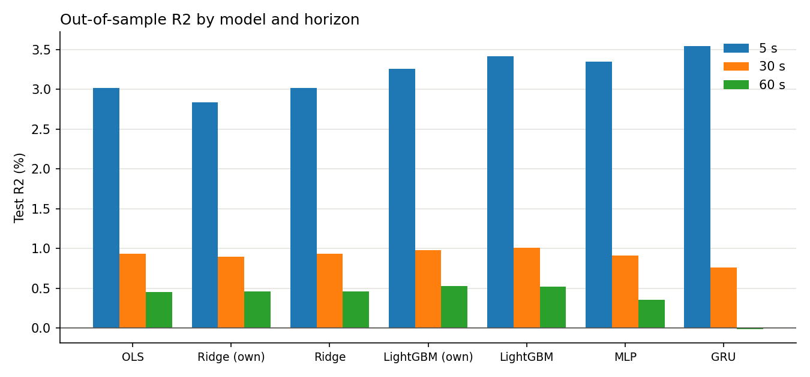
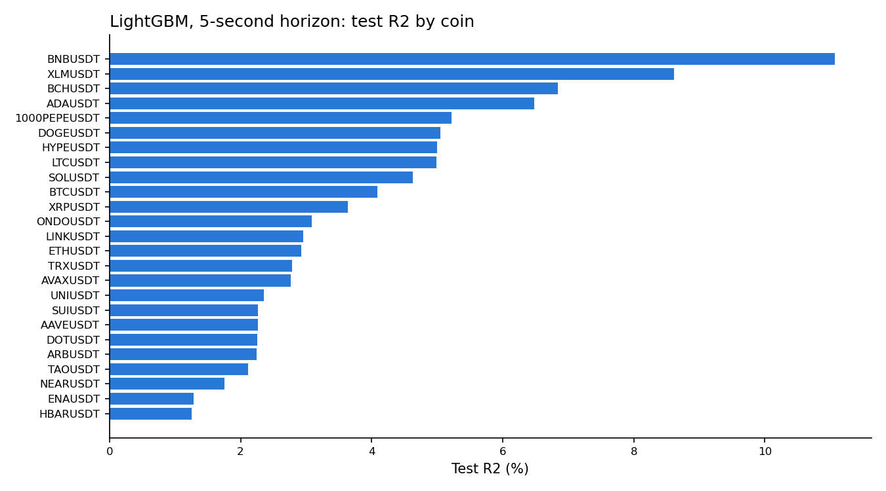

# Predicting short-horizon crypto returns from the Bybit order book

FIN 516 project. Can machine learning predict 5–60 second returns of crypto perpetual futures
better than linear models, using only order-book data? And does any of it survive trading costs?

Full tables: [results/evaluation.md](results/evaluation.md) (forecasts) and
[results/trading.md](results/trading.md) (trading).

## Short answer

1. **Returns are predictable, a little.** At 5 seconds the best models explain about 3.5% of the
   variance (test R2), for every one of the 25 coins and on every test day. At 30 s it is about 1%,
   at 60 s about 0.5%.
2. **Machine learning helps a bit, mostly at 5 s.** LightGBM, the MLP and the GRU beat ridge by
   0.3–0.5 points of R2 at 5 s (significant). At 30–60 s LightGBM is only slightly better than
   ridge, and the neural nets are worse.
3. **Almost all the signal is in the top of the book**: best-level imbalance and the microprice.
4. **BTC and ETH help the other coins a little** at 5 s (+0.2 R2 points, significant), less at
   30 s, not at 60 s.
5. **None of it makes money.** The predicted moves are smaller than the bid-ask spread. Even with
   zero fees, crossing the spread loses about 1 bp per trade. At Bybit's 5.5 bps taker fee, no model
   finds a threshold that works on validation data.

## Data

| | |
|---|---|
| Source | Bybit USDT perpetual futures, order book archive (no trade data used) |
| Raw form | top 5 bid and ask levels (price, size), one snapshot per second |
| Coins | 25: BTC, ETH, SOL, XRP, DOGE, BNB, ADA, AVAX, LINK, SUI, LTC, BCH, DOT, NEAR, UNI, AAVE, HYPE, ENA, TAO, ARB, 1000PEPE, XLM, HBAR, ONDO, TRX |
| Window | 2026-08-03 to 2026-10-11 (10 weeks), UTC |
| Train | Aug 3 – Sep 13 (6 weeks), 18.1M rows |
| Validation | Sep 14 – Sep 27 (2 weeks), 6.0M rows: pick settings and trading thresholds |
| Test | Sep 28 – Oct 11 (2 weeks), 6.0M rows: used once, for the numbers below |

- Features are built every second; we keep one row every 5 seconds per coin.
- Same split dates for every coin. Rows whose target window crosses into the next split are dropped.
- A second counts as bad if Bybit marks the book invalid or restarted, or the book is crossed. We need 600 good
  seconds before a row and good seconds through the target window. (In this window the data had no bad seconds.)
- We picked coins with complete, clean data over the 10 weeks. We left out gold (PAXG), and
  coins with gaps or very thin books (PONS, GRAM, USELESS).

## Features (26)

We kept the list short on purpose. 18 come from the coin's own book, 8 from BTC and ETH.
Every feature at time t uses only data up to t. bps = basis points.

| Feature | What it is |
|---|---|
| `spread` | (ask − bid) / mid, bps |
| `imb1` | (bid size − ask size) / (bid size + ask size), best level |
| `imb5` | same, over the top 5 levels |
| `micro` | microprice − mid, bps. Microprice = size-weighted mid |
| `depth` | log $ value of the top 5 levels, minus its 1-hour average |
| `activity` | log number of book updates in the last 10 s, minus its 1-hour average |
| `ofi_1`, `ofi_5`, `ofi_30` | order-flow imbalance at the best level (Cont, Kukanov & Stoikov 2014), summed over the last 1, 5, 30 s, divided by the 1-hour average best-level size. Our stand-in for signed trade flow |
| `ofi_deep` | same for levels 2–5, last 5 s |
| `ret_1` … `ret_300` | log mid return over the last 1, 5, 30, 60, 300 s |
| `dev_60` | mid minus its 60-second average |
| `rv_60`, `rv_600` | realized volatility over the last 60 and 600 s |
| `btc_` / `eth_` `ret_1`, `ret_5`, `ret_30`, `ofi_5` | the same features for BTC and ETH |

**Target:** log mid return from t to t + h, h = 5, 30, 60 seconds.

**Scaling (train period only, coin by coin):** each feature is standardized and clipped at ±5 sd.
The target is divided by its train sd, so each coin counts about the same in the pooled model. For
training only, targets are clipped at ±10 sd so a few spikes don't drive the fit.

## Models

One pooled model for all 25 coins, one per horizon.

| Model | Details |
|---|---|
| Zero | always predicts 0. Every R2 is measured against it |
| OLS | all 26 features |
| Ridge | L2 penalty picked on validation. With 18M rows it barely differs from OLS |
| LightGBM | tree size (15 or 63 leaves) picked on validation, early stopping on validation, trained on 6M random training rows |
| MLP | 26 → 64 → 32 → 1, ReLU, Adam, early stopping. Average of 3 random starts |
| GRU | reads the last 60 seconds of 8 per-second inputs (own return, spread, both imbalances, microprice, OFI, BTC and ETH returns). Its final state is joined with the 26 features, then 64 → 1. One run |

"(own)" = the same model with only the 18 own-book features.

## How we score

- **R2:** out-of-sample, against a zero forecast: 1 − SSE(model) / SSE(zero). Pooled over coins.
- **hit:** share of rows where forecast and realized return have the same sign (rows with a zero
  return or zero forecast left out).
- **95% CI:** block bootstrap. We resample whole hours (all coins together) 1,000 times, which keeps
  the dependence between nearby rows and between coins.

## Results: forecasting (test period)

| Model | R2 5 s | R2 30 s | R2 60 s |
|---|---|---|---|
| OLS | 3.02 | 0.93 | 0.45 |
| Ridge (own) | 2.84 | 0.89 | 0.46 |
| Ridge | 3.02 [2.78, 3.27] | 0.93 [0.83, 1.04] | 0.46 [0.37, 0.55] |
| LightGBM (own) | 3.26 | 0.98 | 0.53 |
| LightGBM | 3.41 [3.15, 3.69] | **1.01** [0.86, 1.15] | **0.52** [0.36, 0.67] |
| MLP | 3.35 [3.09, 3.61] | 0.91 [0.79, 1.03] | 0.35 [0.13, 0.54] |
| GRU | **3.55** [3.29, 3.81] | 0.76 [0.49, 0.99] | −0.01 [−0.48, 0.37] |

R2 in %. Brackets: 95% CI.

**Machine learning vs ridge** (test R2 difference, % points, 95% CI):

| | 5 s | 30 s | 60 s |
|---|---|---|---|
| LightGBM | +0.40 [0.36, 0.44] | +0.07 [0.01, 0.13] | +0.06 [−0.03, 0.13] |
| MLP | +0.33 [0.30, 0.36] | −0.02 [−0.06, 0.01] | −0.11 [−0.25, 0.01] |
| GRU | +0.53 [0.47, 0.59] | −0.17 [−0.36, −0.03] | −0.47 [−0.87, −0.17] |

- At 5 s every non-linear model wins clearly. The GRU, which sees the last minute second by second,
  is best.
- At 30 and 60 s the extra flexibility mostly fits noise. The GRU stopped improving on validation
  after 1–2 epochs and does worse than ridge on test. Only LightGBM holds up.
- **Robust across coins and days.** At 5 s, R2 is positive for all 25 coins and all 14 test days, for
  every model. Per-coin R2 at 5 s ranges from about 1% (ENA, HBAR) to 7–12% (XLM, BNB).
- **Direction accuracy:** 63–64% at 5 s, 56% at 30 s, 54% at 60 s.

## Results: do BTC and ETH help the other 23 coins?

Test R2 for the 23 coins other than BTC and ETH, own-book features vs own + BTC/ETH:

| | 5 s | 30 s | 60 s |
|---|---|---|---|
| Ridge | +0.19 [0.16, 0.22] | +0.04 [0.01, 0.08] | +0.00 [−0.02, 0.04] |
| LightGBM | +0.16 [0.13, 0.20] | +0.03 [−0.00, 0.06] | −0.00 [−0.04, 0.04] |

Yes at 5 s: the last seconds of BTC and ETH moves and order flow lead the other coins a little.
The effect fades by 30 s and is gone by 60 s.

## Results: which features matter

LightGBM, share of total gain, top features (all 26 in results/evaluation.md):

| Feature | 5 s | 30 s | 60 s |
|---|---|---|---|
| `imb1` (best-level imbalance) | 44% | 39% | 29% |
| `micro` (microprice − mid) | 19% | 25% | 26% |
| `rv_600`, `rv_60` (volatility) | 9% | 6% | 10% |
| `ret_1`, `ret_5`, `ret_300` (own past returns) | 5% | 9% | 12% |
| BTC and ETH features (8 together) | 13% | 12% | 13% |
| everything else (11 features) | 10% | 9% | 10% |

The ridge coefficients tell the same story:
- More size on the bid than on the ask (`imb1`, `micro`) means the price tends to go up next.
- Recent order flow (`ofi_1`, `ofi_5`) predicts the same direction, but only at 5 s.
- Very recent returns (`ret_1`, `dev_60`) partly reverse.

Deeper levels (`imb5`, `ofi_deep`), depth and activity add little.

## Results: trading

**The rules:**
- Taker strategy, $1 per trade, one position per coin at a time.
- Trade when |forecast| is above a threshold.
- Fill 1 second later at the ask (buy) or bid (sell), and close h seconds after that, again crossing the spread.
- The threshold is picked on validation to maximize profit, among thresholds with at least 200 validation trades.

| Fee per side | Result on test |
|---|---|
| 5.5 bps (Bybit standard taker) | No model finds a profitable threshold on validation, so none trades |
| 2 bps | Only 4 of 12 model/horizon pairs trade; all 4 lose (−6.5 to −10.8 bps per trade) |
| 0 bps | 5 s: none profitable on validation. 30–60 s: 7 of 8 lose on test; LightGBM 30 s makes +1.5 bps/trade on 597 trades, t = 0.7, not significant |

**Why:**
- Even the largest forecasts are only a few bps.
- When we trade on every forecast (threshold 0), the average result is −1.0 to −1.2 bps per trade
  for every model and horizon: the forecast edge is smaller than the spread.
- At high thresholds a few trades look profitable, but there are only tens of them. Validation and test disagree.

So the predictability is real but too small to trade as a taker. A market maker who earns the spread
instead of paying it could use these forecasts, for example to decide when to quote or step back. We did not test that.

## Limits

- **10 weeks of data, one market regime.** The test is 2 weeks.
- **No trade data.** Signed trade flow is replaced by order-flow imbalance from the book. With
  1-second snapshots we miss changes inside each second.
- **Fills at the quoted price.** We assume our order fits at the best level and ignore queue
  position and market impact. Real taker results would be the same or worse.
- **The GRU ran once** (one random start), and the neural nets used simple settings, with no large search.
  Better tuning might help them at 30–60 s, but the 5 s ranking is clear.

## Changes from the proposal

| Proposal | Here | Why |
|---|---|---|
| Binance, live WebSocket collection, ~4 weeks | Bybit order-book archive, 10 weeks | The archive already exists on Adroit, and it gives more data |
| Order book + trades | Order book only | Asked for: Bybit book data only. Trade flow is replaced by OFI |
| 20–30 contracts | 25 | |
| 5 s, 30 s, 1 min | same | |
| OLS, ridge, zero, LightGBM, MLP, sequence model | same | |
| Out-of-sample R2, correlation, direction, block bootstrap, per coin / per day | same | |
| Trading with bid/ask, fees, delay | same (1 s delay, 0 / 2 / 5.5 bps fees). No extra slippage beyond the spread | |
